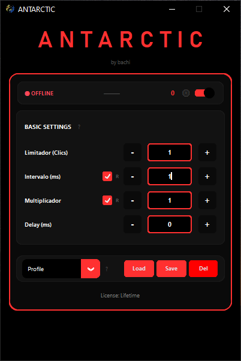
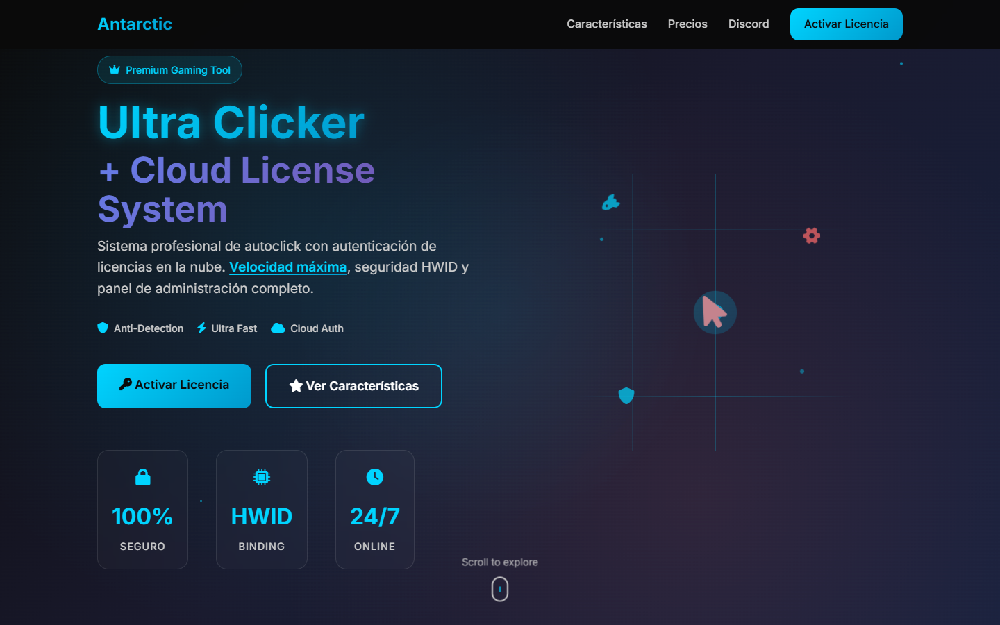

# Antarctic Autoclicker

Autoclicker de alta precisión para Windows, distribuido como producto con **licencias online**. El proyecto completo tiene cuatro partes: la app de escritorio (Python + CustomTkinter), una **API serverless** en Vercel con Supabase para activar y validar licencias, un **panel de administración** web y la **web pública** del producto.

<p align="center"></p>

## Partes del sistema

```
┌────────────────────────┐   POST /api/activate {licenseKey, hwid}   ┌─────────────────────┐
│  App de escritorio     │──────────────────────────────────────────>│ Vercel Functions    │
│  Python · CustomTkinter│   POST /api/validate (sesión)              │ (Node.js)           │
│  PyInstaller + PyArmor │<──────────────────────────────────────────│ rate limit por IP   │
└───────────┬────────────┘                                           └─────────┬───────────┘
            │ WebSocket (DevTools)                                             │
            ▼                                                                  ▼
   juego en Chromium/Electron                                         Supabase (PostgreSQL)
   (medición de latencia)                                                      ▲
                                                                               │ /api/admin/*
                                              ┌──────────────────┐             │
                                              │ Panel admin web  │─────────────┘
                                              └──────────────────┘
```

## App de escritorio (`src/`)

- **Motor de clics de baja latencia.** Envía los mensajes `WM_*BUTTONDOWN/UP` con `PostMessageW` (asíncrono) a la ventana que está bajo el cursor, y usa un temporizador de alta resolución sobre `QueryPerformanceCounter` en lugar de `time.sleep`. Así se sostienen intervalos de pocos milisegundos de forma estable.
- **Controles:** límite de clics, intervalo, multiplicador (clics por grupo) y demora inicial. El intervalo (1 a 75 ms) y el multiplicador (1 a 10) se pueden aleatorizar.
- **Modo máquina perfecta:** intervalo exacto, sin ninguna variación.
- **Botones:** izquierdo, derecho, medio, X1 y X2. Ráfaga con F5.
- **Perfiles:** se guardan y cargan configuraciones con nombre.
- **Compensación de latencia** (`latency_compensator.py`): se conecta por WebSocket al puerto de DevTools de juegos basados en Chromium o Electron, mide el RTT a partir de los frames y ajusta la demora de los clics con la mitad del RTT, con un multiplicador configurable y calibración.
- **Protección del binario** (`security.py`): detección de debugger, de máquina virtual y de herramientas de análisis en ejecución, más verificación de integridad. Se suma a la ofuscación con PyArmor.
- **Modo desarrollo:** desde el código fuente la app arranca sin licencia; el `.exe` compilado (`sys.frozen`) la exige.

## Licencias (`api/`)

Funciones serverless de Vercel sobre Supabase:

| Endpoint | Función |
| --- | --- |
| `POST /api/activate` | Valida la clave y el HWID (SHA-256, 64 hex) y vincula la licencia al equipo en la primera activación |
| `POST /api/validate` | Revalida la sesión periódicamente |
| `GET /api/admin/licenses` · `stats` | Listado y métricas |
| `POST /api/admin/create-license` · `ban-license` · `delete-license` | Gestión de licencias |

Los endpoints públicos tienen rate limiting por identificador (10 activaciones y 20 validaciones por minuto por IP) y las credenciales de Supabase se leen de variables de entorno. Detalle en [docs/API.md](docs/API.md) y [docs/ARCHITECTURE.md](docs/ARCHITECTURE.md).

## Web y panel

| Web pública (`website/`) | Panel de administración (`admin-panel/`) |
| --- | --- |
|  |  |

[Página completa](docs/screenshots/web-completa.png).

## Build y releases

```bash
pip install -r requirements.txt
python src/antarctic.py          # modo desarrollo

compile_antarctic.bat            # PyArmor + PyInstaller → dist/Antarctic.exe
```

`.github/workflows/release.yml` compila en `windows-latest` y publica el ejecutable como release de GitHub al crear un tag. `tools/` contiene el generador de claves, la creación masiva de licencias y el script de release.

## Historia

Empezó en octubre de 2025 como autoclicker con un sistema de patrones de clic. En noviembre lo simplifiqué hacia el modelo actual (intervalo, multiplicador, aleatorización y modo máquina perfecta), migré el backend a Vercel + Supabase y sumé el panel y la web. Son 117 commits.

## Licencia

MIT. Ver [LICENSE](LICENSE).

> Nota: el workflow de CI está en `ci/release.yml.txt`. Moverlo a `.github/workflows/release.yml` para activarlo (requiere permiso de workflows al subir).
